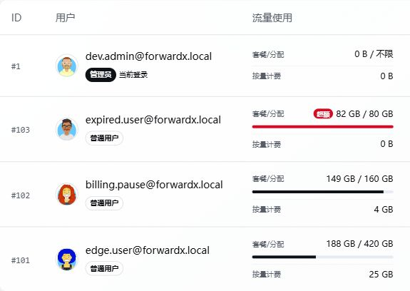

# 用户、套餐和权限

管理员可以在面板中管理用户和套餐。

常见功能：

- 创建用户。
- 设置用户到期时间。
- 设置流量额度。
- 设置最大规则数、端口数。
- 分配可用端口转发、隧道、转发链或转发组资源。
- 配置套餐和价格。
- 配置余额、兑换码、折扣码。
- 配置邮件提醒或 Telegram / Discord 通知。

## 新手建议

如果你只自己使用，可以先不用配置复杂套餐，只保留管理员账户和基础规则即可。

如果要开放给用户使用，建议先规划：

- 每个用户最多可以创建多少规则。
- 每个用户最多可以使用多少端口。
- 每个用户能使用哪些端口转发、隧道、转发链或转发组。
- 流量超额后如何处理。
- 到期前是否发送提醒。

## 权限分配

先创建并验证资源，再在「用户管理 → 目标用户 → 授权」配置使用范围：

1. 普通端口转发选择「端口转发授权」中的资源。
2. 转发链、转发组和隧道在各自的授权区域选择，不要把组成员主机授权当作整组授权。
3. 按需设置用户到期时间、流量额度、规则数和端口数；资源可见不代表这些账户限制被取消。
4. 保存后使用普通用户账号核对可选资源，并创建一条测试规则验证实际 TCP/UDP 业务。

用户自有资源、管理员手动授权和有效套餐授予的资源共同决定可用范围。只授权需要的资源；不要为了让一条规则可用而开放全部主机和链路。

### 网络测试主机权限

「网络测试主机授权」只用于增加网络测试可见主机。普通用户可看到自己创建、通过主机授权或有效套餐授权获得的主机；端口转发、转发链、转发组或隧道的成员主机，不会仅因链路使用权限而单独出现在网络测试列表。

因此，能使用某条链路与能在网络测试中选择其中每台机器是两件事，不需要为使用链路额外开放所有成员主机。

### 修改或撤销授权

用户原有的逻辑规则仍应保留在自己的列表中；失去资源授权后停止转发，并提示重新选择资源，不应直接隐藏或删除规则。用户可以编辑规则，改为当前有权限的端口转发或隧道后继续使用；管理员管理的只读规则仍遵循原有操作限制。

若授权变更后规则完全消失，先核对规则所属用户、筛选条件及面板版本，不要直接删除数据库记录。

## 按流量计费资源

按流量计费产品的「需要授权」决定是否还需管理员单独放行：

| 设置 | 用户使用条件 |
| --- | --- |
| 不需要授权 | 启用的计费资源可按产品规则使用，无需再手动共享同一资源 |
| 需要授权 | 管理员先为该用户授予对应计费资源权限，之后才可使用 |

两种情况仍受产品启用状态、用户状态、余额/信用额度及其他限额约束。「不需要授权」不是免费使用，也不等于授予成员主机的管理权限。配置后分别用未授权和已授权的普通账户验证资源列表及创建规则结果。

## 库存与单用户规则上限

在「套餐管理」编辑订阅套餐或按量计费资源，可设置「库存总量」；`0` 表示不限，用户端显示 `∞`。有限库存显示剩余份数，卖完仍可看到商品。补货时增加总量，而不是把剩余数量填入总量。

- **订阅套餐**：新购、管理员新分配及套餐兑换各占 1 份；待支付订单预占 1 份，取消、过期或创建支付失败后释放。续费不额外占库存。已售订阅到期或取消不返还销售库存。升级前的历史订阅不追溯计数；升级后的新购即使库存不限也累计已占用，后续限量或补货时应在该计数基础上设置总量。
- **按量计费资源**：同一用户使用同一资源只占 1 份库存，创建第一条逻辑规则时占用，删除该用户在该资源上的全部逻辑规则后释放。自动生成的多入口/转发组子规则不重复计数；停用规则不释放库存。
- **单用户规则上限**：仅按量资源提供，`0` 为不限。例如库存 `10`、上限 `3`，最多允许 10 名用户使用，每名用户最多 3 条逻辑规则。库存耗尽后，已占用的用户仍可在个人上限内继续创建规则。

规则编辑、更换资源或更换所属用户也会重新校验。降低库存或规则上限不会删除已有规则，只限制新增。一个规则匹配多个计费配置时，按「转发组 → 隧道 → 主机」优先级占用其中一个资源的库存。

库存校验在数据库事务中实时执行，不使用展示缓存。关闭后才到账的订单会重新检查库存；若已无库存，保留已付款/入账失败记录，管理员应核对后补货重试或通过支付渠道退款。

## 套餐端口数

「连续端口数」填正数时，购买或分配套餐会预留相应数量的连续空闲端口；已取消原来的 1024 个上限，最大值为网络端口范围本身的 65535，实际能否分配取决于绑定资源的共同端口范围和剩余端口。

填 `0` 表示套餐不限制端口数量、不预留固定端口段，用户可在已授权资源允许的范围内选择空闲端口；仍受主机/隧道/转发组的端口策略、端口冲突、规则数等其他限制。不限套餐不会占满端口池，也不会解除其他资源的端口段限制。

修改为不限时，勾选「同步已购用户」才会同步已有订阅；不勾选则保留原权益。不限订阅同步改回有限套餐时，会重新分配连续端口段，需要有足够空闲端口；原有规则不会自动改端口，应核对已有规则是否处于新端口段内。

## 流量统计与重置

### 套餐流量计算方式

在「套餐管理」创建或编辑订阅套餐时，可以选择「流量计算方式」：

- **双向合计**：入向和出向流量相加，默认使用此方式，已有套餐保持不变。
- **单向（仅出向）**：仅出向流量消耗套餐额度，入向仍保留在原始流量统计中。

商店和已购订阅会显示对应方式。同一用户有多个套餐时，按规则使用的资源及套餐分配的端口匹配，不会因为购买一个单向套餐而把其他套餐也改成单向。套餐额度仍沿用现有的用户共享额度池。

修改套餐时，「同步已购用户」决定是否同时更新已有订阅的计算方式；未勾选时，已有订阅保留购买时的方式。切换方式只影响后续扣量，不清零或重算历史用量。套餐外的手动分配规则保持双向计量，独立按量计费产品及规则自身的流量限制不受此选项影响。

### 查看与重置用量

用户列表中的“流量使用”分为两项：

| 统计项 | 含义 |
| --- | --- |
| 套餐/分配 | 用户套餐或管理员分配额度内的已用流量，用于额度和超额状态判断 |
| 按量计费 | 按流量计费规则累计的使用量，便于单独核对计费流量 |



管理员可在目标用户的“更多”菜单中选择“重置流量统计”。手动重置会把页面显示的套餐/分配流量和按量计费流量都从零重新统计，但不会撤销已经产生的扣费记录，也不会修改用户余额。

套餐的定时重置仍只重置套餐/分配流量，不会改变按量计费统计。需要同时重新统计两项时，应使用用户列表中的手动重置操作。

## IP 限制

用户和套餐的「IP 限制」限制**同时使用转发的不同来源 IP 数**，不是单个 IP 的连接数，0 表示不限制。普通端口转发及隧道入口统一按用户、入口主机共享名额；多入口各自在本机计数，不是跨机器的全局 IP 配额。TCP、UDP 共用名额，IPv4 与 IPv6 地址分别占用一个名额。

为减少扫描误占，连接需持续观察至少 5 秒、双向累计流量达到 512 字节才计入；UDP 还须在观察期后继续有数据变化，单次探测回复不会因连接跟踪记录尚未过期就占用名额。同一 IP 的多条连接只占一个名额。TCP 观察到断开后约 10 秒释放；UDP 停止活动后约 30 秒释放。满额后拦截其他 IP 对受限入口的流量，已准入 IP 可继续使用。

这是流量启发式判断，不能替代身份验证：短连接、小流量业务可能不计入，持续发送有效双向流量的扫描也可能被计入。未满额时允许观察流量，不能理解为每次连接都立即严格限额。

需要 Agent **2.2.210 或更新版本**、`ipset`、`iptables`（IPv6 还需 `ip6tables`）、`CAP_NET_ADMIN`，以及可读取的 conntrack 字节统计（`net.netfilter.nf_conntrack_acct=1`）。安装和升级脚本会尝试准备依赖；部分 LXC/受限容器无法启用时会明确报错，转发继续运行，但 IP 限制不保证生效。旧 Agent 不会把新 IP 数量误作旧的单 IP 连接上限，请同步升级。

规则增加或调整不会清空已准入 IP；设为 0 或删除规则会清理对应限制。升级会移除旧的单 IP 连接数限制，独立的「最大连接数」配置保持原有语义。

## 套餐展示说明

订阅套餐和按量计费资源均通过卡片展示，可使用卡片上的拖动手柄调整顺序，松开后自动保存，商店按相同顺序展示符合上架条件的项目。两类产品分别排序；套餐分页时只调整当前页，其他页保持原有相对顺序。排序不影响价格、授权或已购套餐权益。

套餐管理页直接展示「订阅套餐」「按量计费资源」，不再展示顶部数量和账务汇总卡片。右上角「设置」可管理「商店状态」「按量计费」总开关，修改后立即生效；各套餐及计费资源自己的启用、商店展示和授权要求仍单独配置。公开计费资源可在余额充足时使用，需要授权的资源仍须先获得授权。

扣费记录和余额流水在 [账单与兑换](./billing.md) 查询；日期范围、用户范围内的账务汇总在 [运维看板](./operations.md) 查看，不在套餐配置页重复展示。

1. 在套餐管理设置价格、购买时长、额度、规则/端口限制和实际授予的资源。
2. 核对是否启用及是否允许在商店展示，再使用普通账户检查购买入口。
3. 购买或兑换后，检查用户的生效订阅、资源权限和额度，不只检查付款页面。

说明留空时显示系统生成的套餐权益；填写后在管理卡片与商店显示自定义内容。新增套餐默认填入可修改的 Markdown 小模板，编辑已有套餐不会覆盖原说明，卡片上的铅笔图标用于编辑。

说明支持普通文本换行、Markdown（标题、列表、加粗、引用、代码和链接），也支持安全的 H5/HTML 标签（如 `div`、`h3`、`p`、`ul`、`strong`、`a`、`table`）。点击说明旁的「预览」可检查效果，最多 10,000 字符。HTML 与 Markdown 自动识别，建议单次使用一种格式；脚本、事件处理器、嵌入页面和自定义样式会过滤，不支持执行 JavaScript 或完整网页应用。

例如，可将默认模板改为：

```md
## 日常转发套餐
- **线路特色**：填写实际节点与线路介绍
- **使用额度**：填写实际流量、端口与速率
- **售后支持**：填写联系方式

> 购买前请确认套餐权益和使用规则。
```

说明不会改变真实价格、权限、额度或计费规则。管理员应确保展示与实际配置一致。

支付配置见 [支付对接](./payments.md)，订单、余额、兑换码和折扣码见 [账单与兑换](./billing.md)，提醒配置见 [通知与机器人](./notifications.md)。

